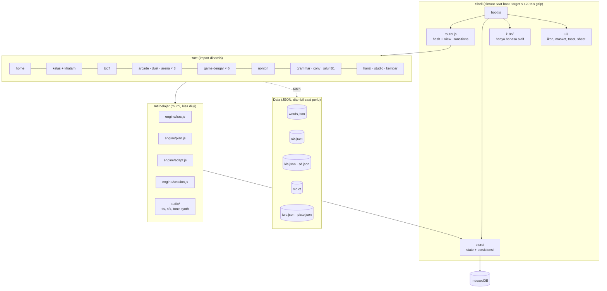
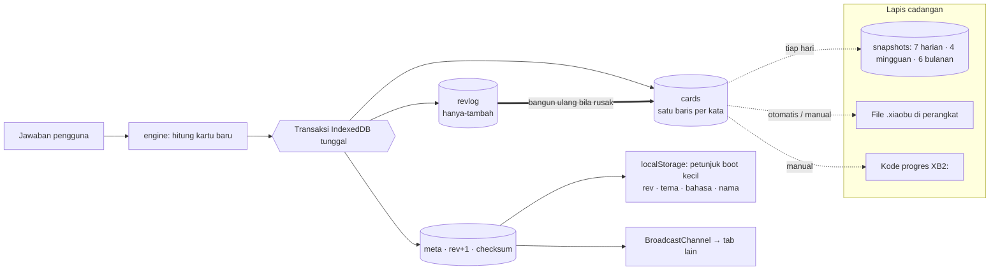
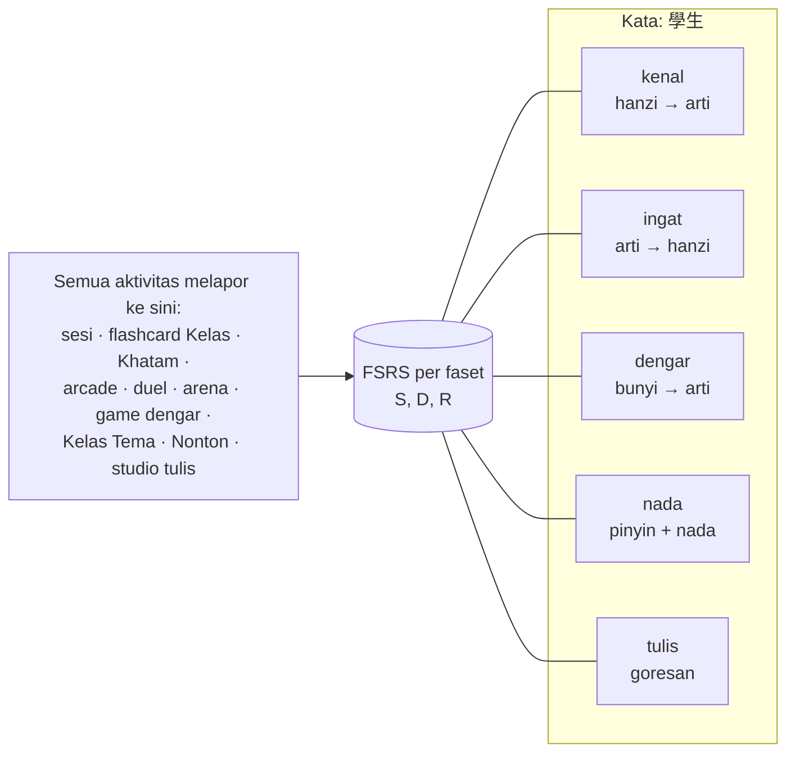
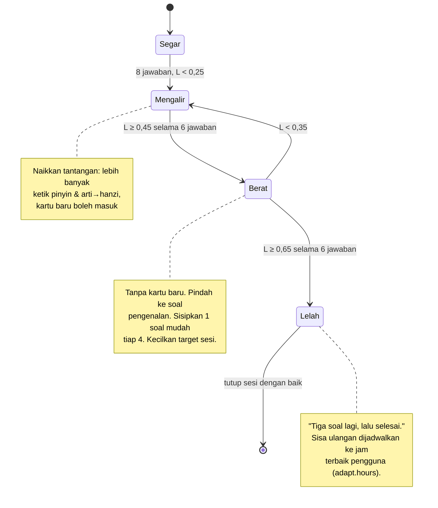
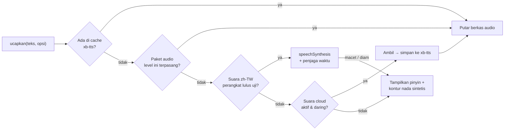
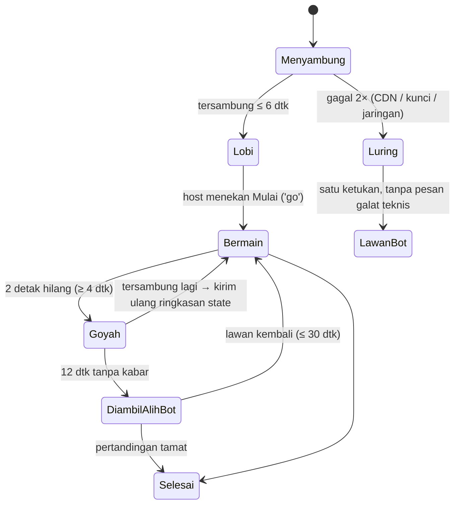
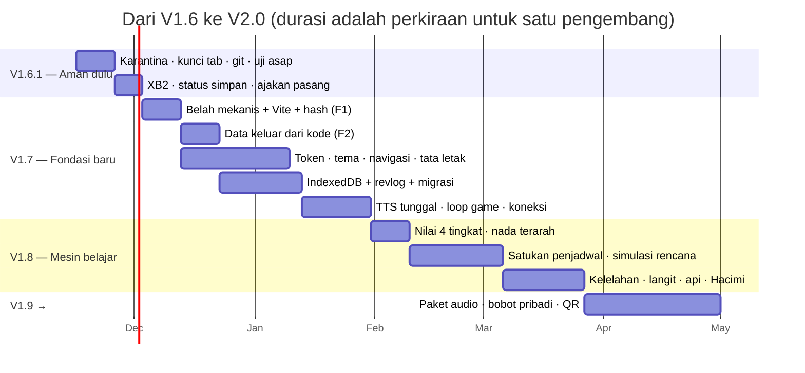

# Blueprint Puncak Potensi — Xiǎobù Kelas V1.6 → V1.7+

| | |
|---|---|
| **Untuk** | Pemilik produk Xiǎobù Kelas |
| **Dasar** | [PRD.md](PRD.md) dan pengukuran langsung pada `app.js`, `app.css`, `sw.js` di folder ini |
| **Tanggal** | 11 November 2026 |

> **Cara baca.** Angka bertanda *(terukur)* dihitung dari kode di folder ini. Rekomendasi belum diuji di perangkat; tiap fase punya kriteria lulus supaya bisa dibuktikan sebelum lanjut. Hal yang perlu diverifikasi dulu ditandai **[verifikasi]**.

---

## Status pengerjaan (12 November 2026) — V1.7 tahap pertama

Dikerjakan sebagai lapisan baru `peak.js` + `peak.css` di atas `app.js`, plus lima suntingan kecil di `app.js`. Diuji di browser lokal: boot tanpa galat, 23 rute terbuka, dan tiap butir di bawah dijalankan.

| Butir peta jalan | Status |
|---|---|
| 1 · Karantina state gagal-baca (D4) | **Selesai** — salinan mentah disimpan, pita pemulihan muncul |
| 2 · Penjaga antar-tab (D5) | **Selesai** — tab tanpa perubahan memuat ulang; tab dengan perubahan menggabung per kartu |
| 4 · Status penyimpanan terlihat | **Selesai** — kartu baru di menu Saya |
| 5 · Kode progres ber-checksum | **Selesai** — `XB2:`; kode terpotong ditolak. Impor masih menimpa (dengan snapshot pengaman), belum menggabung |
| Snapshot berjenjang 7·4·6 | **Selesai** |
| Log jawaban hanya-tambah (bagian dari 12) | **Selesai** — IndexedDB `xiaobu-rev`; `localStorage` masih sumber kebenaran |
| 11 · Mikro-interaksi inti | **Selesai** — ketukan, benar/salah, garis nada, getar, transisi rute |
| Api streak & Hacimi (bagian dari 21) | **Selesai, versi sederhana** — api terisi mengikuti misi harian (0–3) dan menyala sekali di misi ketiga; ekor Hacimi berayun dan telinganya berkedut di beranda. Api "lima lidah nada" dan langit generatif belum |
| Tema Malam (bagian dari 8) | **Selesai** |
| 16 · Nilai 4 tingkat dari waktu jawab | **Selesai** |
| 19 · Model kelelahan | **Selesai** untuk Sesi pintar (tunda kata baru → pendekkan sesi) |
| 20 · Matriks nada | **Sebagian** — peluruhan 3%/hari; pasangan nada yang paling sering tertukar dijamin muncul sebagai pengecoh (sebelumnya hanya kadang-kadang). Pencatatan per pasangan suku kata dan resep latihan otomatis belum |
| 6 · Belah mekanis `app.js` (F1) | **Selesai tanpa Node** — 111 potongan di `src/app/`, dirakit `build.ps1`; hasil rakit identik byte-per-byte dengan `app.js` semula |
| Impor/pulih = gabung · cermin langsung IndexedDB · tawaran pulih saat state kosong | **Selesai** |
| Langit harian generatif · batas DPR kanvas · penjaga ucapan langsung | **Selesai** (langit bisa dimatikan di menu Saya) |
| 13 penjaga TTS, 18 anggaran menit harian, sebagian 17 | **Sudah ada di V1.6** — `TTS.speak` punya penjaga, `dailyMin` membatasi porsi, dan flashcard Kelas/arcade sudah menilai lewat FSRS. Diagnosis D7 saya berlebihan |
| 3 · Uji otomatis | **Selesai tanpa Node** — buka `tes.html`: 40 uji (FSRS, kode progres, gabung, snapshot, nada, kelelahan, karantina, 23 halaman). Penyimpanan dikunci selama uji. `git` belum |
| Target ingatan FSRS (bagian dari 23) | **Selesai** — pilihan 85% / 90% / 93% di menu Saya. Bobot pribadi belum |
| 9 · Lima tujuan navigasi | **Sudah ada di V1.6** — menu "Lainnya" sudah dikelompokkan: Belajar, Latihan, Kampus & kerja, Main, Saya |
| Node + git (13 Nov 2026) | **Terpasang** — repo git aktif; `npm run build / cek / rilis / uji`. `rilis` mengganti penanda `k170` dengan hash isi file, jadi versi cache naik sendiri. `uji` menjalankan 40 uji di Edge tanpa jendela |
| Vite | **Tidak dipakai, sengaja** — Vite tidak mengolah skrip klasik non-modul, jadi belum memberi apa-apa sampai kode jadi modul ES. Manfaat yang dijanjikan (hash otomatis, cek sintaks) sudah didapat lewat `build.mjs` tanpa dependensi |
| 7, 10, 12 (penuh), 14 (loop bersama), 15, 22, 24, 25 | **Belum** — konversi ke modul ES adalah pekerjaan bertahap per rute; duel butuh dua perangkat; paket audio butuh rekaman |

**Koreksi atas bagian 2.** Setelah app dijalankan, ternyata tampilan aktifnya sudah memakai sistem token yang lebih baru (aksen mawar `--acc: #d93a74`, `--surface`, `--line`, skala `--s1…--s6`) dan efek kaca sudah dimatikan oleh aturan di bagian akhir `app.css`. Palet plum/lavender di 2.1–2.2 saya ambil dari awal `app.css` yang sudah tertimpa, jadi **abaikan nilai warna di sana**; arah desainnya (garis nada sebagai identitas, tiga tema, anggaran efek) tetap berlaku dan tema Malam dibangun di atas token mawar yang asli.

---

## 0. Diagnosis: apa yang sebenarnya menahan app ini

Tujuh temuan berikut menentukan seluruh urutan kerja. Semuanya dari kode, bukan dugaan.

| # | Temuan *(terukur)* | Akibat |
|---|---|---|
| D1 | `app.js` = 24.226 baris, **1.395 fungsi global** dan **713 `const`/`let` tingkat atas** dalam satu ruang nama | Nama bisa bertabrakan diam-diam; tidak ada batas modul yang bisa diuji |
| D2 | **12 penimpaan fungsi global** (`render = function…`, `afterRender = …`, `closeModal = …`) dengan 10 salinan "versi lama" | Urutan muat menentukan perilaku. Modul baru membungkus modul lama; satu salah urut = bug tak terlihat |
| D3 | `app.js` sudah berupa **gabungan file asli** — komentarnya masih menyebut `voice.js`, `premode.js`, `b1core.js`, `b1gram.js`, `b1conv.js`, `b1path.js`, `b1hub.js`, `nonton.js`, `khatam.js`, `listgame.js`, `arena_boat.js`, dst. | Kabar baik: batas modul sudah ada. Pemecahan bisa mekanis, bukan penulisan ulang |
| D4 | `load()` baris 4369: bila perbaikan state gagal → `S = d` (state kosong), lalu `save()` menimpa `xiaobu.v1` | **Satu pengecualian saat muat bisa menghapus seluruh progres.** Ini risiko data terbesar di app |
| D5 | `save()` menulis **seluruh `S`** sebagai satu JSON tiap 300 ms; tidak ada `BroadcastChannel` maupun `navigator.locks` | Dua tab terbuka = tab yang terakhir menyimpan menang, progres tab lain hilang. Tiap jawaban men-serialisasi ribuan kartu |
| D6 | `app.css`: **70 `backdrop-filter`, 63 `filter: blur`, 346 `box-shadow`, 191 `@keyframes`, 104 `!important`, 180 `@media`** dengan ≥14 breakpoint berbeda (380, 420, 480, 520, 560, 640, 700, 760, 900, 1025, 1180 …) | Biaya GPU tidak terkendali; tidak ada sistem — tiap layar punya aturan sendiri |
| D7 | **Lima penjadwal ulangan berjalan paralel**: FSRS (`S.cards`), kotak Leitner di flashcard Kelas, ulang buku Khatam 1·3·7·14·30 (`S.kb.rv`), tangga menulis (`S.hzw`), dan progres per game (`S.lg`, `S.tema`) | Kata yang sama dijadwalkan lima kali tanpa saling tahu. Beban ulangan pengguna lebih besar dari yang perlu |

**Kesimpulan.** Urutannya: amankan data (D4, D5) → pecah monolit lewat batas yang sudah ada (D3) → baru naikkan visual dan mesin belajar. Membalik urutan ini berarti mempercantik app yang masih bisa kehilangan progres penggunanya.

---

## 1. Arsitektur & modernisasi kode

### 1.1 Keputusan

| Pertanyaan | Keputusan | Alasan |
|---|---|---|
| Bundler? | **Ya, Vite** — hanya sebagai alat build | Hash nama file otomatis menggantikan `k160` manual; pemecahan kode per rute; tetap menghasilkan folder statis |
| Framework (React/Vue/Svelte)? | **Tidak** | 300 pemakaian `innerHTML` dan render berbasis string sudah berfungsi; menulis ulang 23 rute tidak menambah nilai bagi murid. Cukup ES Modules + satu pustaka kecil untuk pembaruan DOM bertarget di layar yang butuh |
| TypeScript? | **JSDoc + `tsc --checkJs`**, bukan konversi `.ts` | Dapat pengecekan tipe untuk `S`, kartu FSRS, dan data lesson tanpa mengganti satu baris sintaks |
| Tes? | **Playwright (asap, 23 rute) + Vitest (mesin murni)** | FSRS, `planToday`, kode progres `XB1:`, dan migrasi state adalah fungsi murni yang paling mahal bila salah |

### 1.2 Sifat "PWA statis no-cache" tetap utuh

Hasil `vite build` tetap folder statis yang bisa ditaruh di Netlify apa adanya. Yang berubah hanya cara versi dikelola:

| Sekarang | Sesudah |
|---|---|
| `?v=k160` ditulis tangan di `index.html` + `sw.js` (`V`, `CORE`) | Nama file ber-hash isi: `app-3f9a1c.js`. Lupa menaikkan versi tidak mungkin lagi |
| Semua aset `cache-first` dengan kunci versi manual | `/assets/*` → `Cache-Control: public, max-age=31536000, immutable`. `index.html`, `sw.js`, `manifest.webmanifest` tetap `no-cache` |
| Daftar `CORE` ditulis tangan | Daftar precache dibuat saat build (plugin kecil yang menyuntik manifest ke `sw.js`) |
| Cache `xb-tts*` dikecualikan dari pembersihan | Dipertahankan persis — itu aset pengguna, bukan aset rilis |

```toml
# netlify.toml (sesudah)
[build]
  command = "npm run build"
  publish = "dist"

[[headers]]
  for = "/assets/*"
  [headers.values]
    Cache-Control = "public, max-age=31536000, immutable"

[[headers]]
  for = "/sw.js"
  [headers.values]
    Cache-Control = "no-cache"
# index.html dan "/" tetap no-cache seperti sekarang
```

Strategi shell `network-first` dengan batas 3,5 detik di `sw.js` sudah tepat dan dipertahankan.

### 1.3 Struktur target



**Aturan ketergantungan** (ditegakkan lint): rute boleh mengimpor inti dan `ui`; inti tidak boleh mengimpor rute atau menyentuh DOM; `store` tidak mengimpor siapa pun.

### 1.4 Pengganti pola "timpa fungsi global" (D2)

Dua belas penimpaan `render = function…` diganti satu registri kait. Urutan muat tidak lagi menentukan perilaku.

```js
// core/hooks.js
const H = { afterRender: [], closeModal: [], beforeSession: [] };
export const on = (name, fn, order = 0) => { H[name].push({ fn, order }); H[name].sort((a, b) => a.order - b.order); };
export const run = (name, ...a) => { for (const h of H[name]) h.fn(...a); };

// routes/kelas/index.js — sebelumnya: afterRender = function () { afterRenderK(); … }
on('afterRender', route => { if (route === 'kelas') document.getElementById('app').classList.add('wide'); });
```

Pendaftaran rute juga pindah dari `ROUTES.splice(...)` yang tersebar di 7 tempat ke satu tabel deklaratif (`routes/index.js`) berisi id, ikon, grup navigasi, dan fungsi `load: () => import('./nonton/index.js')`.

### 1.5 Fase pemecahan (pola *strangler*)

| Fase | Isi | Kriteria lulus | Risiko |
|---|---|---|---|
| **F0 · Jaring pengaman** | `git init`; Playwright membuka 23 rute dan menjalankan 1 sesi tiap jenis; 6 berkas state contoh (kosong, hari-1, 500 kartu, 3.000 kartu, state V0.8 lama, state rusak) diuji lewat `load()`; perbaiki D4 | Semua rute tanpa galat konsol; keenam state termuat tanpa kehilangan kartu | Sangat rendah |
| **F1 · Belah mekanis** | Potong `app.js` di 75 komentar banner `/* ==========` menjadi `src/legacy/NN-nama.js`. Build menggabungkannya kembali **dalam urutan yang sama** sebagai skrip klasik | `dist/app.js` identik byte-per-byte dengan `app.js` sekarang (selain spasi) | Nol — tidak ada perubahan perilaku |
| **F2 · Data keluar dari kode** | `KLS` (1,1 MB), `TEMA`, `TWD`, `GRAM2`, `CONV`, `PICTO`, `COMP_ORIGIN`, `CH_T`, `VIX` pindah ke JSON yang diambil saat rute dibuka. I18N dipecah per bahasa | `app.js` turun dari 4,8 MB ke < 900 KB; boot hanya memuat bahasa aktif | Rendah |
| **F3 · Inti jadi ESM** | `fsrs`, `plan`, `adapt`, `session builders`, kode progres, migrasi → modul murni + Vitest. Sisa legacy mengaksesnya lewat `window.XB` sementara | ≥ 90% cakupan baris pada `engine/` dan `store/` | Sedang |
| **F4 · Rute jadi ESM** | Satu rute per PR, mulai dari yang paling terisolasi: `nonton` → `tocfl` → arena × 3 → `lgame` → `kelas`. Tiap rute diimpor dinamis | Tidak ada lagi penimpaan global; `window.XB` kosong | Sedang |
| **F5 · Bersih** | Hapus `legacy/`, aktifkan `checkJs` ketat, anggaran ukuran di CI | Shell ≤ 120 KB gzip; tiap rute ≤ 80 KB gzip | Rendah |

F0–F2 bisa selesai tanpa pengguna melihat perubahan apa pun. Itu disengaja.

---

## 2. Transformasi UI/UX

### 2.1 Rencana desain

**Subjek.** Murid dan pekerja migran yang belajar Mandarin Taiwan 10 menit sehari di HP kelas menengah, sering sambil di kereta atau sebelum shift. Tugas utama layar: memberi tahu *satu hal* yang dikerjakan sekarang.

**Satu hal yang berani: garis nada.** Yang membedakan Mandarin dari bahasa lain yang mereka kenal adalah nada, dan app ini sudah punya lima warna nada (`--t1`…`--t5`) serta sintesis kontur Chao. Jadikan itu identitas visual: kontur nada digambar sebagai satu goresan menyambung di bawah setiap kata, dan lima warna itu menjadi *satu-satunya* warna aksen di seluruh app. Api streak, cincin progres, grafik kurva lupa, dan transisi rute semuanya memakai bentuk dan warna yang sama. Semua yang lain dibuat tenang.

**Yang saya ubah dari arah awal.** Rancangan pertama saya adalah "kaca pastel dengan gradien lavender–peach di tiap kartu" — itu persis tampilan sekarang yang diperhalus, dan itu juga tampilan bawaan aplikasi belajar mana pun. Saya membuangnya: kaca dibatasi ke dua permukaan navigasi, kartu menjadi kertas padat, dan warna hanya muncul bila membawa arti (nada, benar/salah, jatuh tempo).

**Palet inti.**

| Nama | Terang | Redup | Malam | Peran |
|---|---|---|---|---|
| Kertas | `#FBF9FF` | `#2A2640` | `#0D0B14` | Latar halaman |
| Lembar | `#FFFFFF` | `#35304F` | `#17141F` | Kartu, sheet |
| Tinta | `#2A2540` | `#ECE8FA` | `#E4E0F2` | Teks utama |
| Tinta lembut | `#6A6487` | `#B4AED0` | `#9A94B5` | Teks sekunder |
| Plum | `#5B4D8A` | `#B9A8FF` | `#A996FF` | Aksi utama, fokus |
| Garis | `#E6E0F5` | `#48426A` | `#2A2637` | Pembatas 1 px |

**Tiga tema, tiga maksud.** *Terang* untuk siang. *Redup* untuk belajar malam di kamar: kontras sengaja diturunkan (±9:1, bukan 16:1) supaya hanzi tidak menyilaukan. *Malam* untuk layar OLED dan "ulang sebelum tidur": hampir hitam tapi tidak `#000`, karena hitam murni membuat piksel OLED mati-nyala dan teks berbayang saat digulir. Saat ini app hanya punya `light` dan `dark`; *Malam* adalah tema baru.

**Warna nada** — dipertahankan karena pengguna sudah menghafalnya, tetapi diberi pasangan "tinta" agar terbaca sebagai teks:

| Nada | Isian (grafis) | Tinta di Terang (teks ≥ 4,5:1) | Bentuk |
|---|---|---|---|
| 1 | `#5B9CF5` | `#2F6FD0` | datar tinggi ‾ |
| 2 | `#2FB385` | `#1B8560` | naik ⟋ |
| 3 | `#E19A1F` | `#9A6500` | lekuk ⌄ |
| 4 | `#EC6B80` | `#C73B55` | turun ⟍ |
| netral | `#9A93B5` | `#6A6487` | titik · |

Nada tidak pernah disampaikan dengan warna saja: bentuk kontur selalu menyertai, sehingga pengguna buta warna tetap bisa membaca.

**Huruf.**

| Peran | Huruf | Catatan |
|---|---|---|
| Hanzi | LXGW WenKai TC (dipertahankan) | Bentuk kuas-tulis memperlihatkan arah goresan — itu alasan pedagogis, bukan hiasan |
| Antarmuka & pinyin | Plus Jakarta Sans (dipertahankan), `font-feature-settings: "tnum"` untuk angka | Tanda nada pada ǎ ǚ harus diuji; cadangan `Noto Sans` |
| Cadangan hanzi | `"PingFang TC", "Noto Sans TC", "Microsoft JhengHei"` | WenKai ±MB per irisan; tampilkan cadangan dulu (`font-display: swap`) |

Dua keluarga ini sudah khas dan tepat untuk subjeknya; menggantinya hanya demi "baru" adalah kerugian.

### 2.2 Arsitektur CSS

`app.css` (5.321 baris) dipecah menjadi lapisan bertingkat sehingga 104 `!important` tidak diperlukan lagi:

```css
@layer reset, tokens, base, layout, components, routes, utilities, overrides;
```

Tiga tingkat token — komponen **hanya** boleh memakai tingkat 2 dan 3:

```css
@layer tokens {
  :root {
    /* 1 · primitif: tidak dipakai langsung */
    --plum-500: #5B4D8A;  --paper-0: #FBF9FF;  --ink-900: #2A2540;

    /* 2 · semantik: inilah yang ditukar tiap tema */
    --surface-page: var(--paper-0);
    --surface-card: #fff;
    --text: var(--ink-900);
    --text-soft: #6A6487;
    --action: var(--plum-500);
    --line: #E6E0F5;
    --ok: #1B8560;  --bad: #C73B55;

    /* ruang: kelipatan 4, tanpa nilai liar */
    --s1: 4px; --s2: 8px; --s3: 12px; --s4: 16px; --s5: 24px; --s6: 32px; --s7: 48px;

    /* radius menyandi hierarki, bukan satu nilai untuk semua */
    --r-chip: 10px; --r-card: 20px; --r-sheet: 28px; --r-full: 999px;

    /* kedalaman: 3 tingkat saja (menggantikan 346 box-shadow) */
    --e1: 0 1px 2px rgb(42 37 64 / .06);
    --e2: 0 6px 16px -6px rgb(42 37 64 / .16);
    --e3: 0 18px 40px -14px rgb(42 37 64 / .28);

    /* gerak */
    --d-tap: 90ms; --d-in: 220ms; --d-out: 160ms; --d-page: 320ms;
    --ease-out: cubic-bezier(.2, .8, .2, 1);
    --ease-pegas: linear(0, .36 9%, .78 20%, 1.03 32%, 1.07 40%, 1.02 55%, .995 72%, 1);
  }
  :root[data-theme="redup"] { --surface-page: #2A2640; --surface-card: #35304F; --text: #ECE8FA; /* … */ }
  :root[data-theme="malam"] { --surface-page: #0D0B14; --surface-card: #17141F; --text: #E4E0F2; /* … */
    --e1: none; --e2: 0 0 0 1px var(--line); --e3: 0 0 0 1px var(--line), 0 20px 40px -10px #000; }
}
```

Di tema Malam, kedalaman dinyatakan dengan **garis tepi dan beda kecerahan permukaan**, bukan bayangan — bayangan di atas hampir-hitam tidak terlihat dan hanya membuang kerja GPU.

### 2.3 Skala huruf khusus hanzi & pinyin

Hanzi butuh ukuran jauh lebih besar dari huruf Latin untuk keterbacaan goresan yang sama. Skala dibuat terpisah dan pinyin **diturunkan dari** ukuran hanzi induknya:

| Token | Ukuran | Dipakai untuk |
|---|---|---|
| `--hz-pahlawan` | `clamp(72px, 22vw, 128px)` | Kartu belajar, hanzi hari ini |
| `--hz-kata` | `clamp(36px, 10vw, 56px)` | Kata dalam soal |
| `--hz-kalimat` | `clamp(22px, 5.6vw, 30px)` | Dialog, lirik Nonton, kalimat nyata |
| `--hz-daftar` | `20px` | Baris kamus, tabel tema |
| `--hz-rapat` | `17px` | Batas bawah. Di bawah ini goresan 灣 atau 體 menyatu |

```css
.hz { font-family: var(--f-hanzi); line-height: 1.25; font-size: var(--hz, var(--hz-kata)); }
ruby.kata { ruby-position: over; ruby-align: center; }
ruby.kata > rt {
  font: 500 clamp(11px, .42em, 18px)/1 var(--f-ui);   /* 0,42 × hanzi induk */
  letter-spacing: .01em; padding-bottom: .28em; color: var(--tone-ink, var(--text-soft));
}
:root[data-xpy="off"] rt { visibility: hidden; }       /* tinggi baris tidak melompat */
```

Dua aturan yang memperbaiki masalah nyata: (1) pinyin disembunyikan dengan `visibility`, bukan `display`, supaya tata letak tidak bergeser ketika lembar Mode mematikan pinyin; (2) lebar tiap suku kata minimal `2.1em` supaya `zhuāng` tidak menabrak tetangganya.

Teks antarmuka memakai skala modular 1,2 dari 15 px: 12,5 · 15 · 18 · 21,6 · 26 · 31. Panjang baris penjelasan dibatasi `max-inline-size: 62ch`.

### 2.4 Kaca, kedalaman, dan gradasi tanpa lag

Angka D6 berarti satu layar bisa memuat belasan permukaan blur bertumpuk. Tiap `backdrop-filter` memaksa browser mengambil ulang dan mengaburkan semua piksel di belakangnya setiap kali ada yang bergerak.

**Anggaran efek** — aturan keras, dicek lint:

| Efek | Jatah per layar | Tempat |
|---|---|---|
| `backdrop-filter` | **≤ 2** | Bar tab bawah dan kepala halaman/sheet. Tidak pernah di kartu, tidak pernah di dalam area gulir |
| `filter: blur()` hidup | **0** | Diganti gradien radial atau bitmap yang sudah dikaburkan |
| `box-shadow` | 3 token (`--e1`…`--e3`) | Tidak pernah dianimasikan |
| Properti yang dianimasikan | `transform`, `opacity` saja | Bayangan "tumbuh" = pseudo-elemen dengan bayangan lebih besar yang `opacity`-nya dianimasikan |

**"Kaca kertas" untuk kartu** — tampak tembus, biayanya nol:

```css
.card {
  background:
    linear-gradient(180deg, rgb(255 255 255 / .9), rgb(255 255 255 / .72)),  /* isi */
    var(--surface-card);
  border: 1px solid transparent;
  background-clip: padding-box, border-box;
  box-shadow: var(--e1), inset 0 1px 0 rgb(255 255 255 / .9);  /* kilau tepi atas */
  border-radius: var(--r-card);
  contain: layout paint;                 /* perubahan di dalam tidak merambat keluar */
}
```

**Langit harian — latar generatif yang dirender sekali.** Empat gumpalan `.sky > i` yang dianimasikan dan dikaburkan diganti satu kanvas yang digambar **sekali per hari**: medan aliran dari derau berbenih (benih = tanggal + hari streak), garis-garisnya mengikuti kontur lima nada dengan proporsi nada kata-kata yang jatuh tempo hari itu. Hasilnya di-`toBlob()` menjadi gambar latar statis, disimpan di Cache Storage. Tiap hari langitnya berbeda dan *milik pengguna itu*, tetapi biaya per frame nol. Di perangkat `lite`, pakai dua gradien radial statis.

```js
// ui/sky.js — sekali per hari, di luar jalur kritis
requestIdleCallback(async () => {
  const key = `sky-${todayKey()}-${theme}`;
  if (await skyCache.has(key)) return apply(await skyCache.url(key));
  const c = new OffscreenCanvas(540, 960);          // setengah resolusi, diregang CSS
  drawToneField(c.getContext('2d'), seedOf(key), toneMixOfDueWords());
  apply(URL.createObjectURL(await c.convertToBlob({ type: 'image/webp', quality: .8 })));
});
```

**Tiga tingkat kualitas** menggantikan sakelar biner `lite`. `applyPerf()` sudah mendeteksi RAM dan jumlah inti; tambahkan pengukuran nyata — hitung frame yang terlewat pada 2 detik pertama dan turunkan tingkat bila > 10%:

| Tingkat | Syarat | Kaca | Langit | Partikel | Batas DPR kanvas |
|---|---|---|---|---|---|
| Penuh | ≥ 6 GB, frame stabil | 2 permukaan | generatif | ya | 2 |
| Seimbang | bawaan | 1 (bar bawah) | generatif | dikurangi | 1,5 |
| Ringan | ≤ 4 GB / frame jatuh / pilihan pengguna | 0 (padat 96%) | gradien statis | tidak | 1 |

### 2.5 Mikro-interaksi

**Prinsip.** Gerak hanya menjawab tindakan pengguna atau menandai satu peristiwa yang layak dirayakan. Tidak ada animasi masuk "fade + geser ke atas" pada tiap bagian. Semua gerak dibungkus `@media (prefers-reduced-motion: no-preference)`; versi tenangnya adalah perubahan warna seketika.

| Momen | Rancangan | Teknik |
|---|---|---|
| **Ketukan** pada kartu/tombol | Turun `scale(.97)` dalam 90 ms saat `pointerdown`, kembali dengan pegas saat lepas. Respons muncul *saat jari menyentuh*, bukan saat `click` | CSS `:active` + `--ease-pegas`; `touch-action: manipulation` menghapus jeda 300 ms |
| **Jawaban benar** | Pilihan terisi `--ok`; garis nada kata itu "tergambar" kiri-ke-kanan (240 ms) sementara pelafalan diputar; getar 12 ms | `stroke-dashoffset` pada SVG kontur; `navigator.vibrate(12)` |
| **Jawaban salah** | Pilihan bergeser 6 px dua kali (bukan goyang panjang), jawaban benar disorot, penjelasan naik dari bawah. Tanpa warna merah penuh layar | WAAPI `el.animate([{translate:'-6px'},{translate:'6px'},{translate:0}], 180)`; getar `[20, 40, 20]` |
| **Combo** | Penghitung bertambah dengan angka lama keluar ke atas, baru masuk dari bawah; pada 5, 10, 20 garis nada berkilau sekali | `@property --n` atau dua `<span>` yang ditukar |
| **Api streak** | Nyala dibangun dari **lima lidah berbentuk kontur nada**, masing-masing warna nadanya, bergoyang dengan fase berbeda. Tiga misi selesai → kelima lidah menyala berurutan. Streak beku → lidah menjadi garis diam berwarna es | 5 `<path>` SVG, `transform: scaleY()` + `skewX()` dengan `animation-delay` bertingkat; hanya berjalan saat terlihat (IntersectionObserver) |
| **Maskot Hacimi** | Bagian SVG terpisah (telinga, mata, ekor, tangan) dengan `transform-origin` di sendinya. Diam: kedip tiap 4–7 dtk + ekor berayun. Tujuh ekspresi berpindah lewat tukar-kelas dengan `opacity` silang 120 ms. Bereaksi pada peristiwa: `wow` saat combo 10, `sleepy` setelah 22.00, `oops` yang lembut saat salah tiga kali beruntun | CSS `steps()` untuk kedip; pegas untuk reaksi; animasi diam berhenti saat tab tersembunyi |
| **Transisi rute** | Maju = konten baru menggeser 24 px dari kanan + pudar; mundur = kebalikannya; pindah tab = pudar silang saja. Hanzi yang diketuk di daftar **membesar menjadi** hanzi pahlawan di halaman detail | View Transitions API (`document.startViewTransition`) + `view-transition-name: hz-<id>`; tanpa dukungan → render langsung seperti sekarang |
| **Sesi selesai** | Satu momen terorkestrasi: cincin progres menutup → XP menghitung naik → Hacimi `joy`. Total ≤ 1,2 dtk, bisa dilewati dengan ketukan | Satu `Animation` berantai lewat `finished` |

```js
// ui/transition.js — pembungkus yang aman
export function swap(update, dir = 'maju') {
  if (!document.startViewTransition || matchMedia('(prefers-reduced-motion: reduce)').matches) return update();
  document.documentElement.dataset.nav = dir;
  return document.startViewTransition(update).finished;
}
```

**Getar.** `navigator.vibrate` saat ini dipanggil 2 kali di seluruh app. Buat satu modul `haptic.js` dengan kosakata tetap — `ketuk` 8 ms, `benar` 12 ms, `salah` [20,40,20], `rayakan` [10,30,10,30,40] — dan sakelar di Pengaturan. API ini tidak tersedia di Safari iOS; di sana umpan balik dibawa oleh suara dan gerak, tanpa upaya mengakali.

**Jaminan 60–120 fps.** Semua animasi di atas berjalan di kompositor (`transform`/`opacity`), jadi mengikuti laju layar 120 Hz tanpa kode tambahan. Yang dilarang: menganimasikan `width`, `height`, `top`, `box-shadow`, `filter`; dan `will-change` permanen (saat ini 3 pemakaian — pasang sesaat sebelum animasi, lepas sesudahnya).

### 2.6 Tata letak adaptif

**Masalah.** 23 rute berbagi satu daftar datar; bar bawah hanya memuat 4 dan sisanya di "Lainnya". Belasan breakpoint berbeda membuat tiap layar berperilaku sendiri.

**Lima tujuan menggantikan 23 butir menu:**

| Tujuan | Isi (rute sekarang) | Pertanyaan yang dijawab |
|---|---|---|
| **Hari ini** | `home`, `memory` | Apa yang kukerjakan sekarang? |
| **Belajar** | `kelas`, `path`, Kelas Tema, Jalur A2→B1, `grammar`, `hanzi`, `write` | Materi apa berikutnya? |
| **Latih** | `listen`, `lgame`, `conv`, `nonton`, `tones`, `arcade`, `arena`, Duel | Aku mau berlatih atau bermain |
| **Pustaka** | `words`, `kalimat`, `slang`, `twins`, `fab`, `kampus` | Aku mau mencari sesuatu |
| **Saya** | `prog`, `stats`, `me` | Seberapa jauh aku? |

Rute hash lama tetap berlaku; yang berubah hanya pengelompokan navigasi.

**Tiga kelas ukuran** menggantikan ≥14 breakpoint, dan komponen memakai *container query* (app sudah punya 6 `@container`) supaya kartu yang sama benar di panel sempit maupun lebar:

```
Ringkas  < 600 px            Sedang  600–1023 px                 Lapang  ≥ 1024 px
┌──────────────────┐   ┌────┬───────────────┬──────────┐   ┌──────────┬────────────────────┬───────────┐
│ kepala (kaca)    │   │    │               │          │   │ Hari ini │                    │ konteks   │
├──────────────────┤   │ r  │  daftar       │ detail   │   │ Belajar  │   konten utama     │ ─ ingatan │
│                  │   │ e  │  (lesson,     │ (kata,   │   │ Latih    │   maks 720 px      │ ─ jatuh   │
│  SATU tindakan   │   │ l  │   kata, pola) │  dialog, │   │ Pustaka  │                    │   tempo   │
│  utama           │   │    │               │  papan   │   │ Saya     │                    │ ─ Hacimi  │
│                  │   │    │               │  tulis)  │   │          │                    │           │
│  lalu ringkasan  │   │    │               │          │   │          │                    │           │
├──────────────────┤   │    │               │          │   │          │                    │           │
│ ⌂  ▤  ▷  ☰  ◔   │   └────┴───────────────┴──────────┘   └──────────┴────────────────────┴───────────┘
└──────────────────┘    rel 72 px · 2 panel 2fr / 3fr       sidebar 240 · konten · rel konteks 300
```

```css
.app { display: grid; grid-template: "kepala" auto "isi" 1fr "tab" auto / 1fr; min-height: 100dvh; }
@media (min-width: 600px)  { .app { grid-template: "rel isi" 1fr / 72px 1fr; } }
@media (min-width: 1024px) { .app { grid-template: "sisi isi konteks" 1fr / 240px minmax(0, 720px) 300px; justify-content: center; } }

.panel { container-type: inline-size; }
@container (min-width: 520px) { .lesson-card { grid-template-columns: auto 1fr auto; } }
```

**Mengurai kepadatan tanpa membuang data:**

1. **Satu tindakan utama per layar.** Beranda sekarang menumpuk rute harian, misi, kekuatan ingatan, mode cepat, peringkat, dan pengingat cadangan. Sesudahnya: satu tombol besar "Lanjutkan — 8 kata baru, 23 ulangan", di bawahnya tiga ringkasan satu baris yang bisa dibuka.
2. **Rincian bertahap.** Angka ringkas di permukaan; grafik (kurva lupa, tren 30 hari) di balik satu ketukan — sebagai sheet di HP, sebagai panel kanan di tablet/desktop.
3. **Daftar panjang divirtualkan.** Kamus 10.941 kata saat ini dibatasi `VS.lim = 120` lalu "muat lagi". Pakai `content-visibility: auto; contain-intrinsic-size: auto 64px` pada baris — gulir mulus tanpa pustaka.
4. **Zona ibu jari.** Di HP, semua aksi sesi berada di 40% bawah layar; kepala hanya menampilkan progres dan tombol keluar.
5. **Ruang aman.** `padding-bottom: max(var(--s4), env(safe-area-inset-bottom))` pada bar bawah; `100dvh`, bukan `100vh`.

**Catatan penulisan antarmuka.** Label huruf besar semua (`INGAT`, `UJIAN AKHIR`, `REKOR BARU!`) diganti huruf kalimat dengan bobot dan ukuran sebagai penanda hierarki. Nama tindakan sama dari awal sampai akhir alur: tombol "Simpan ke kartu hafalan" menghasilkan toast "Tersimpan ke kartu hafalan".

---

## 3. Ketahanan data

### 3.1 Tiga perbaikan yang harus masuk sebelum apa pun (V1.6.1)

Ini bisa dikerjakan di `app.js` yang sekarang, tanpa menunggu refactor.

**(a) Jangan pernah menimpa data yang gagal dibaca (D4).**

```js
function load() {
  const rawText = localStorage.getItem(KEY);
  let raw = null;
  try { raw = JSON.parse(rawText); } catch (e) { quarantine(rawText, 'parse'); }
  // … perbaikan seperti sekarang …
  } catch (e) {
    quarantine(rawText, 'repair');   // simpan apa adanya ke IndexedDB + kunci xiaobu.karantina.<ts>
    SAVE_LOCK = true;                // JANGAN simpan state kosong di atas data lama
    return showRecovery();           // layar: pulihkan snapshot · tempel kode · mulai baru (eksplisit)
  }
}
```

**(b) Satu penulis antar-tab (D5).**

```js
const ch = new BroadcastChannel('xiaobu');
navigator.locks?.request('xiaobu-penulis', { mode: 'exclusive' }, () => new Promise(() => {}))   // tab ini pemilik
ch.onmessage = e => { if (e.data.t === 'saved' && e.data.rev > REV) reloadStateFromDisk(); };
// tab yang tidak memegang kunci: mode baca + ajakan "Lanjutkan di tab ini"
```

**(c) Tampilkan status penyimpanan dengan jujur.** `navigator.storage.persist()` sudah dipanggil (baris 8298, 12638) tetapi hasilnya tidak pernah diperlihatkan, dan `storage.estimate()` belum dipakai. Di menu Saya tampilkan: "Penyimpanan permanen: aktif / belum" + pemakaian + tanggal cadangan terakhir.

### 3.2 Arsitektur persistensi target

Prinsip: **riwayat jawaban adalah kebenaran; state adalah turunan.** Bila state rusak, ia dibangun ulang dari log.



| Penyimpanan | Isi | Mengapa |
|---|---|---|
| IndexedDB `revlog` | `{t, w (bentuk hanzi), jenis, nilai 1–4, ms, s, d}` per jawaban, hanya-tambah | Sumber kebenaran; bahan optimasi FSRS (bagian 4); ±40 byte/baris → 100.000 jawaban ≈ 4 MB |
| IndexedDB `cards` | Satu baris per kata, kunci = bentuk hanzi (sudah stabil sejak V0.9) | Menulis **satu baris** per jawaban, bukan seluruh `S` |
| IndexedDB `kv` | `settings`, `days`, `streak`, `adapt`, `prog`, `kb`, `hzw`, `tema`, `conv`, `nonton`… per kunci | Irisan kecil ditulis terpisah |
| IndexedDB `snapshots` | Salinan terkompresi berjenjang | Sekarang hanya 5 terakhir: kerusakan yang baru disadari setelah seminggu sudah tidak tertolong |
| `localStorage` | Petunjuk boot < 2 KB + cermin darurat `xiaobu.v1` yang ditulis 1×/menit | Boot tanpa kedip tema; jalur mundur bila IndexedDB tidak tersedia |

**Mode Penjelajahan Pribadi / IndexedDB gagal:** app berjalan dari memori + `localStorage`, dengan pita tetap di atas: "Progres tidak akan tersimpan di jendela pribadi" dan tombol "Salin kode progres".

### 3.3 Skema berversi dan migrasi

`S.v` sekarang selalu `1` dan perbaikan dilakukan ad hoc di dalam `load()`. Ganti dengan rantai migrasi bernomor, tiap langkah fungsi murni yang diuji terhadap berkas state contoh dari F0:

```js
export const MIGRASI = [
  /* 1→2 */ s => ({ ...s, v: 2, revlog: [] }),
  /* 2→3 */ s => gabungPenjadwal(s),            // lihat 4.1: lima penjadwal → satu
];
// sebelum migrasi: snapshot wajib berlabel "pra-migrasi-vN", tidak ikut rotasi
```

### 3.4 Memaksimalkan penyimpanan permanen

| Platform | Perilaku | Tindakan |
|---|---|---|
| **iOS Safari (tab biasa)** | Data yang ditulis skrip bisa dihapus setelah ±7 hari tanpa kunjungan | **Pasang ke Layar Utama adalah perlindungan data, bukan sekadar kenyamanan** — app terpasang dikecualikan dari batas itu **[verifikasi pada versi iOS sasaran]**. Ubah ajakan pasang: muncul setelah sesi ke-2, dengan alasan "supaya progresmu tidak dihapus iPhone" |
| **Android Chrome** | `persist()` dikabulkan otomatis bila app terpasang atau sering dipakai | Panggil ulang `persist()` setelah pemasangan dan setelah sesi ke-3, bukan hanya saat boot |
| **Desktop Chromium** | Mendukung File System Access | Tawarkan "Pilih folder cadangan": app menyimpan *handle* dan menulis `xiaobu-cadangan.xiaobu` otomatis setiap hari tanpa bertanya lagi |
| **Semua** | — | `storage.estimate()` tiap boot; peringatan bila pemakaian > 80% kuota |

### 3.5 Cadangan yang mulus

| Jalur | Sekarang | Sesudah |
|---|---|---|
| **Kode progres** | `XB1:` = JSON → gzip → base64; `XB0:` tanpa kompresi | `XB2:` menambah **CRC32 + nomor skema** di kepala, sehingga kode yang terpotong saat ditempel di chat terdeteksi sebelum menimpa apa pun. `XB0:`/`XB1:` tetap bisa dibaca |
| **File cadangan** | Unduh / share sheet | Ekstensi `.xiaobu`; di Android/desktop daftarkan `file_handlers` di manifest supaya **mengetuk file langsung membuka app dan menawarkan pemulihan** **[verifikasi dukungan]** |
| **Pindah HP** | Salin-tempel teks panjang | **Kode QR beruntun**: state dipecah jadi beberapa bingkai QR yang berganti; HP baru memindainya lewat kamera. Tanpa server, tanpa mengetik |
| **Impor** | Menimpa | **Gabung per kartu**: menang yang `last review`-nya lebih baru; `revlog` disatukan dan dideduplikasi berdasar `(t, w)`. Ada pratinjau "akan memulihkan 1.240 kata, 86 hari" sebelum konfirmasi |
| **Pengingat** | Setelah sejumlah kata | Berbasis risiko: belum terpasang **dan** belum permanen **dan** > 7 hari sejak cadangan → pengingat. Bila sudah ada cadangan otomatis ke folder, tidak pernah mengganggu |

**Kriteria lulus bagian 3:** uji otomatis yang (1) mematikan tab di tengah transaksi, (2) memuat keenam state contoh termasuk yang rusak, (3) membuka dua tab dan menjawab di keduanya, (4) memulihkan dari tiap jalur cadangan — tanpa kehilangan satu kartu pun.

---

## 4. Mesin belajar

### 4.1 Satukan lima penjadwal (D7) — dampak terbesar

Satu **catatan ingatan per kata**, dengan *faset* untuk keterampilan yang memang berbeda:



| Sekarang | Sesudah |
|---|---|
| Flashcard Kelas: kotak Leitner sendiri | Tampilan lain dari catatan FSRS yang sama |
| Khatam: jadwal tetap 1·3·7·14·30 hari | Jadwal ulang *lesson* tetap ada sebagai konsep, tetapi isi soalnya dipilih dari kata-kata lesson itu yang `R`-nya terendah |
| `S.hzw`: tangga menulis dengan interval sendiri | Faset `tulis` |
| `S.lg`, `S.tema`: hitungan benar/salah per game | Jawaban game masuk `revlog` dengan bobot rendah (lihat 4.2) |

Hasil bagi pengguna: kata yang baru saja dijawab benar di Arena tidak muncul lagi sepuluh menit kemudian di ulangan harian.

### 4.2 Dari biner ke penilaian empat tingkat otomatis

Sebagian besar soal hanya menghasilkan benar/salah, padahal FSRS dirancang untuk empat nilai. Waktu jawab sudah dicatat (`adapt.rt`). Turunkan nilai secara otomatis:

```
z = (ln(ms) − μ[jenis, panjangKata]) / σ[jenis, panjangKata]      // dibandingkan dengan diri sendiri

salah                         → 1 Lupa
benar, z > +1,0  atau pakai petunjuk → 2 Sulit
benar, −1,0 ≤ z ≤ +1,0        → 3 Bisa
benar, z < −1,0               → 4 Mudah
```

`μ` dan `σ` adalah rata-rata bergerak per pengguna, per jenis soal, per panjang kata — sehingga soal ketik pinyin tidak dibandingkan dengan pilihan ganda. Jawaban dari game berwaktu (arcade, ritme) diberi **bobot 0,5** saat memperbarui stabilitas, karena tekanan waktu menaikkan tebakan.

### 4.3 Parameter pribadi

FSRS saat ini memakai bobot bawaan untuk semua orang. Dengan `revlog` (bagian 3), dua tingkat personalisasi menjadi mungkin:

| Tingkat | Syarat | Cara | Biaya |
|---|---|---|---|
| **Retensi sasaran adaptif** | ≥ 200 jawaban | Sasaran bawaan 0,90. Bila beban harian terproyeksi melebihi `dailyMin` pengguna → turunkan bertahap ke ≥ 0,85; menjelang tanggal tes TOCFL yang diisi pengguna → naikkan ke 0,93 | Nol |
| **Bobot pribadi** | ≥ 1.000 jawaban | Optimasi bobot dengan penurunan gradien pada log-loss, di **Web Worker**, sebulan sekali saat perangkat diisi daya dan menganggur. Hasil diterima hanya bila log-loss pada 20% data tertahan membaik | ±detik di HP menengah **[verifikasi; bandingkan dengan implementasi rujukan `ts-fsrs`]** |

Tambahan kecil yang berdampak: **fuzz** ±5% pada interval (mencegah gumpalan jatuh tempo di hari yang sama), **penguburan saudara** (dua faset kata yang sama tidak muncul dalam satu sesi), dan **deteksi lintah** — kata dengan ≥ 6 lupa dikeluarkan dari antrean dan dikirim ke perlakuan lain: cerita buatan sendiri di Hanzi Lab, Huruf Kembar, atau kalimat nyata.

### 4.4 Rencana harian berbasis simulasi

`planToday()` sekarang memakai ambang tetap (tumpukan > 80 → ×0,75; > 150 → ×0,5; akurasi < 72% → ×0,8). Ganti dengan pertanyaan langsung: *"bila hari ini ditambah n kata, berapa menit ulangan per hari dalam 14 hari ke depan?"*

```
untuk n dalam [0 … 40]:
    simulasikan 14 hari (R tiap kartu dari FSRS, kartu baru masuk n/hari)
    beban[n] = maks menit harian terproyeksi
pilih n terbesar dengan beban[n] ≤ menit yang dipilih pengguna (S.dailyMin)
```

Simulasinya murah (ribuan kartu × 14 hari, sekali sehari) dan alasannya bisa ditampilkan apa adanya: "8 kata hari ini menjaga ulanganmu di bawah 12 menit sampai minggu depan." Ini melanjutkan kebiasaan baik app yang sudah menampilkan `why`.

### 4.5 Prediksi kelelahan dan sesi yang menyesuaikan diri

**Sinyal** — semuanya sudah atau hampir tersedia di `S.adapt`:

| Sinyal | Rumus (jendela 12 jawaban terakhir vs 12 pertama sesi) | Arti |
|---|---|---|
| Pelambatan | kemiringan `z` waktu jawab | Mulai berat |
| Ketidakstabilan | simpangan baku `z` naik | Perhatian naik-turun |
| Jawaban kilat salah | `ms < 0,4 × median` **dan** salah | Menebak asal |
| Lupa pada kartu matang | salah pada kartu dengan `R > 0,9` | Bukan soal ingatan — soal fokus |
| Keluar-masuk | `visibilitychange` di tengah soal | Terganggu |
| Riwayat | sesi serupa (jam, hari) yang berakhir `quit` | Pola pribadi |

```
L = 0,30·pelambatan + 0,20·ketidakstabilan + 0,20·kilatSalah + 0,20·lupaMatang + 0,10·gangguan
    (tiap suku dinormalkan 0–1, lalu dihaluskan EWMA α = 0,3)
```



**Perubahan antarmuka seketika, tanpa menggurui:**

- *Berat:* bilah progres memendek ("tinggal 5"), pinyin muncul otomatis untuk kata bernilai `D` tinggi, Hacimi beralih ke `think` — tanpa dialog, tanpa kata "lelah".
- *Lelah:* tawaran, bukan paksaan: "Cukup untuk sekarang? Sisanya paling pas jam 20.00." Streak hari itu tetap dihitung.
- *Mengalir:* jangan diganggu sama sekali — tidak ada toast, tidak ada lencana di tengah sesi; semua perayaan ditahan sampai akhir.

Prinsip pengaman: mesin ini hanya boleh **meringankan atau menawarkan**, tidak pernah mengunci atau menghukum. Ukuran keberhasilannya: rasio `adapt.quit / adapt.done` turun.

### 4.6 Matriks kekeliruan nada 5×5 → pengajar nada

`adapt.tc` saat ini hanya penghitung mentah. Jadikan ia penggerak:

1. **Peluruhan.** Tiap hari `tc ← 0,97 × tc`, supaya kesalahan bulan lalu tidak menghantui.
2. **Peluang, bukan hitungan.** Tiap sel `(benar=i, dijawab=j)` menjadi sebaran Beta; pakai batas atas kepercayaan agar pasangan yang jarang diuji tetap ikut diuji.
3. **Pengecoh terarah.** Di soal nada, pilihan salah diambil dari kolom yang paling sering tertukar bagi pengguna *itu* (klasik: 2↔3, 1↔4), bukan acak.
4. **Konteks, bukan nada tunggal.** Perluas pencatatan ke **pasangan dua suku kata** (20 kombinasi) dan kasus sandhi (3+3, 不 sebelum nada 4, 一). Banyak pembelajar benar pada nada tunggal tetapi salah pada nada 3 di tengah kata.
5. **Resep otomatis.** Sel terburuk memicu latihan 90 detik: dengar kontur murni dari `TONE CONTOUR SYNTH` → pasangan minimal → kata nyata dari dek pengguna. Game Dengar "Pemburu Nada" mengambil antreannya dari sini.
6. **Perlihatkan.** Di halaman Nada, matriks ditampilkan sebagai 5×5 titik berwarna nada yang ukurannya = tingkat tertukar. Pengguna melihat kelemahannya sendiri dalam satu pandangan.

Pola yang sama berlaku untuk hanzi: setiap pilihan salah menambah sisi pada **graf tertukar** (`已 ↔ 己`), yang lalu mengisi Huruf Kembar dan Huruf Kembar Bergerak dengan pasangan milik pengguna, bukan daftar tetap.

---

## 5. Kinerja game, multimedia, dan realtime

### 5.1 Standar kinerja

| Ukuran | Sasaran (HP ≤ 4 GB RAM) |
|---|---|
| Frame game | ≥ 55 fps rata-rata; ≤ 1% frame > 32 ms |
| Respons ketukan → perubahan visual | ≤ 50 ms |
| Tugas utas utama saat bermain | tidak ada > 50 ms |
| Sampah memori dalam loop | 0 alokasi per frame |
| Latensi suara efek | ≤ 30 ms dari peristiwa |
| Memori puncak satu game | ≤ 120 MB |

### 5.2 Satu loop game untuk semuanya

Balap Perahu Naga, Ritme Idol, Duel Kalimat, 漢字 Monster, Hujan Kata, dan Duel Hanzi masing-masing punya loop sendiri (23 `requestAnimationFrame`, 13 `setInterval` di seluruh app). Satu modul `game/loop.js` menegakkan aturan yang sama:

```js
export function loop({ update, render, stepMs = 1000 / 60 }) {
  let last = performance.now(), acc = 0, id = 0, on = true;
  const tick = now => {
    if (!on) return;
    acc += Math.min(now - last, 100); last = now;          // tab kembali dari latar: jangan meledak
    while (acc >= stepMs) { update(stepMs); acc -= stepMs; } // logika langkah-tetap: sama di 60 & 120 Hz
    render(acc / stepMs);                                    // interpolasi → halus di 120 Hz
    id = requestAnimationFrame(tick);
  };
  const vis = () => { on = !document.hidden; if (on) { last = performance.now(); id = requestAnimationFrame(tick); } else cancelAnimationFrame(id); };
  document.addEventListener('visibilitychange', vis); id = requestAnimationFrame(tick);
  return () => { on = false; cancelAnimationFrame(id); document.removeEventListener('visibilitychange', vis); };
}
```

Langkah-tetap juga membuat mode online adil: kedua HP menghitung hal yang sama dari seed yang sama, terlepas dari laju layarnya.

**Aturan kanvas:**

| Aturan | Alasan |
|---|---|
| Batasi resolusi: `dpr = min(devicePixelRatio, tingkat === 'ringan' ? 1 : 1.5)` | HP murah ber-DPR 3 menggambar 9× piksel; ini sumber lag terbesar |
| **Atlas hanzi**: tiap hanzi yang dipakai sesi digambar sekali ke kanvas luar-layar, lalu `drawImage` | `fillText` huruf CJK dengan WenKai mahal; Ritme Idol dan Hujan Kata memanggilnya tiap frame |
| Latar paralaks dirender ke lapisan terpisah, digeser dengan `transform` CSS | Tidak menggambar ulang gunung dan air tiap frame |
| Tanpa `shadowBlur`, tanpa `filter` kanvas; cahaya = sprite gradien yang sudah jadi | Keduanya memaksa jalur lambat |
| Kolam objek untuk partikel, not, dan peluru | Nol alokasi → tanpa jeda pengumpul sampah |
| `canvas.getContext('2d', { alpha: false, desynchronized: true })` untuk kanvas layar penuh | Kompositor lebih murah, latensi masukan lebih rendah |
| Masukan lewat `pointerdown` (bukan `click`), `touch-action: none` di kanvas | Ritme Idol butuh ketepatan waktu |

**Suara.** Ada 4 pembuatan `AudioContext`; jadikan **satu** konteks bersama yang dibuka pada ketukan pertama. Untuk Ritme Idol, jadwalkan not dan nilai ketepatan terhadap `audioCtx.currentTime`, bukan `performance.now()`, dan sediakan kalibrasi latensi sekali ("ketuk mengikuti bunyi" × 8) yang disimpan per perangkat — headset Bluetooth bisa menambah 150–250 ms.

### 5.3 Huruf Kembar Bergerak

Mesin morf sudah benar secara algoritma (resample K titik per sisi, pencocokan Hungaria). Yang perlu diatur adalah *kapan* pekerjaan dilakukan:

1. **Hitung sekali, simpan.** Resample + pencocokan untuk satu pasangan dijalankan di Web Worker saat set dibuka, hasilnya `Float32Array` yang disimpan di IndexedDB. `TWD` (220 KB) pindah ke JSON sesuai F2.
2. **Satu jalur, bukan banyak elemen.** Tiap frame hanya interpolasi linear dua `Float32Array` lalu satu `Path2D` di kanvas — atau satu atribut `d` pada satu `<path>`. Tidak ada tata letak, tidak ada elemen SVG per goresan.
3. **Mini di galeri = gambar diam.** Pratinjau beranimasi hanya untuk kartu yang terlihat dan hanya satu sekaligus.

### 5.4 Nonton & Dengar — sinkron tanpa tersendat

| Masalah | Solusi |
|---|---|
| Waktu dari pemutar YouTube datang lewat pesan antar-bingkai dan tidak tiap frame | **Jam lokal terinterpolasi**: simpan `(tVideo, tPerf)` terakhir; di antara pembaruan, `t = tVideo + (performance.now() − tPerf) × laju`. Koreksi halus bila selisih > 120 ms; lompat bila > 500 ms (pengguna menggeser) |
| Mencari baris aktif di ≤ 1.500 baris | Pencarian biner sekali, lalu hanya periksa "apakah sudah lewat awal baris berikutnya" |
| Menyentuh DOM tiap frame | DOM diubah **hanya saat baris berganti**: tukar satu kelas. Sorotan per kata (bila ada waktu per kata) memakai satu `--p` pada baris aktif |
| Gulir otomatis tersendat | `scrollTo({ behavior: 'smooth' })` sekali per ganti baris; daftar memakai `content-visibility: auto` |
| Menguraikan kalimat (kamus 5 MB) saat teks dimuat | Segmentasi + pencarian kamus di **Web Worker**; kamus disimpan sebagai tabel terurut + pencarian biner, bukan satu objek raksasa di memori |
| Jeda shadowing meleset | Jadwalkan jeda dengan jam terinterpolasi yang sama, 80 ms sebelum akhir baris |

Bingkai YouTube sendiri memakan memori besar. Di perangkat `ringan`, tawarkan "mode suara + teks" sebagai bawaan dan muat video hanya atas permintaan.

### 5.5 TTS: satu lapisan yang tahu kelemahan tiap perangkat

`speechSynthesis` dipanggil di 70 tempat. V1.5 sudah menyatukan *pilihan suara*; langkah berikutnya menyatukan *perilaku*. Semua panggilan lewat satu `audio/tts.js` dengan rantai mundur:



**Uji kelayakan saat boot** (sekali per perangkat, hasil disimpan): ucapkan satu suku kata tanpa suara terdengar, ukur apakah `onstart`/`onend` terpanggil dan berapa lama. Dari situ app tahu kelakuan perangkat itu tanpa menebak dari nama browser.

**Penjaga untuk cacat yang umum** **[verifikasi tiap butir pada perangkat uji]**:

| Gejala | Penanganan |
|---|---|
| `onend` tidak pernah terpanggil | Penjaga waktu: `(jumlah suku kata × 420 ms ÷ laju) + 1,5 dtk`; lewat itu, anggap selesai dan lanjutkan sesi |
| Ucapan panjang terpotong | Pecah per kalimat/baris; antre sendiri, jangan andalkan antrean bawaan |
| Daftar suara kosong saat boot | Tunggu `voiceschanged` dengan batas 3 dtk; `onVoices()` sudah ada, tinggal dipusatkan |
| Tidak bersuara sebelum ada sentuhan | "Buka kunci" suara pada ketukan pertama; `autoplay` baru aktif sesudahnya |
| Suara `zh-TW` tidak ada, hanya `zh-CN` | Pakai dengan label jujur (sudah dilakukan: "Belum ada suara Taiwan — memakai …") dan tawarkan paket audio |
| `cancel()` lalu `speak()` beruntun diam | Sisipkan jeda 60 ms di antaranya |

**Paket audio per level** adalah jawaban tuntas untuk inkonsistensi: rekaman satu suara Taiwan untuk 3.426 kata A2, dikemas per level (Novice 1 = 200 kata), diunduh atas pilihan pengguna ke cache `xb-tts` yang sudah dikecualikan dari pembersihan di `sw.js`. Perkiraan ±6–10 KB per kata (Opus) → seluruh A2 ±25–35 MB, Novice 1 ±2 MB. Kata di luar paket memakai rantai di atas.

### 5.6 Supabase Realtime: Duel dan Arena yang tidak pernah "macet"

Rancangan sekarang sudah punya fondasi yang benar: seed bersama, hanya aksi kecil yang dikirim, dua CDN cadangan untuk pustaka, dan larik kunci (`DL_SB.keys`). Yang ditambahkan adalah **mesin status koneksi yang eksplisit**:



| Kegagalan | Mitigasi |
|---|---|
| Pustaka Supabase gagal dimuat dari kedua CDN | **Sertakan pustaka di bundel rute duel** (F4) — hilang satu titik gagal, dan mode online bisa dibuka dari cache |
| Proyek Supabase mati / kuota habis | Lobi langsung menawarkan **Lawan bot** dan **2 pemain di 1 HP**; tidak ada layar buntu. Bot memakai seed dan soal yang sama |
| Lawan terputus di tengah | "Lawan terputus… menunggu" sudah ada. Tambahkan: setelah 12 dtk **bot mengambil alih** dengan akurasi dan kecepatan lawan sejauh ini, sehingga pertandingan selesai dan hasilnya tetap berarti |
| Pesan hilang / tiba ganda | Tiap aksi bernomor urut per pemain; penerima mengabaikan duplikat dan meminta ulang bila ada lompatan. Detak tiap 2 dtk membawa `{hp, skor, urut}` sebagai titik rujuk |
| Selisih waktu antar-HP | Jam bersama = median selisih dari 5 pertukaran ping saat lobi; semua tenggat soal dihitung dari jam itu |
| Jaringan pabrik/kampus memblokir WebSocket | Deteksi dalam 6 dtk → mode luring otomatis dengan penjelasan satu kalimat |

**Keamanan aset Supabase** (pertanyaan terbuka PRD):

1. **Kunci `anon` di klien memang dirancang untuk terbuka** — keamanan datang dari kebijakan, bukan dari menyembunyikannya. Jangan pernah menaruh kunci `service_role` di klien. Saya memeriksa: yang ada di `app.js` baris 10916 berada dalam larik `keys` konfigurasi klien; **pastikan itu memang kunci `anon`**.
2. **Proyek ini hanya untuk Realtime.** Tanpa tabel berisi data pengguna; RLS aktif di semua tabel; skema `public` tidak punya tabel yang bisa ditulis `anon`.
3. **Otorisasi kanal.** Aktifkan Realtime Authorization sehingga `anon` hanya boleh memakai topik berawalan `xbduel-` (komentar kode sudah mengisyaratkan kebijakan ini) dan menolak sisanya **[verifikasi di dasbor]**.
4. **Batasi beban.** `eventsPerSecond: 30` sudah disetel di klien; setel juga batas di sisi proyek, dan batasi ukuran pesan. Validasi bentuk setiap pesan masuk di klien — pesan asing dibuang, bukan dipercaya.
5. **Kode room 6 karakter acak**, bukan berurutan; room kedaluwarsa setelah 30 menit sepi.
6. **Pantau kuota** koneksi serentak; saat mendekati batas, lobi menurunkan diri ke "antre atau lawan bot".
7. **Rencana keluar.** Karena hanya butuh *presence + broadcast*, penyedia bisa diganti tanpa mengubah game: bungkus dalam antarmuka `Transport { join, send, on, leave }` (ARNET sudah mendekati ini).

---

## 6. Peta jalan

### 6.1 Matriks prioritas

| # | Pekerjaan | Dampak | Usaha | Rilis |
|---|---|---|---|---|
| 1 | Karantina state gagal-baca, jangan timpa (D4) | **Tinggi** | Rendah | V1.6.1 |
| 2 | Satu penulis antar-tab (D5) | **Tinggi** | Rendah | V1.6.1 |
| 3 | `git init` + uji asap 23 rute + 6 state contoh | **Tinggi** | Rendah | V1.6.1 |
| 4 | Status penyimpanan terlihat + ajakan pasang berbasis risiko | Tinggi | Rendah | V1.6.1 |
| 5 | Kode progres `XB2:` ber-checksum; impor = gabung | Tinggi | Rendah | V1.6.1 |
| 6 | Belah mekanis `app.js` (F1) + Vite + hash berkas | Tinggi | Sedang | V1.7 |
| 7 | Data keluar dari kode (F2): `app.js` 4,8 MB → < 0,9 MB | **Tinggi** | Sedang | V1.7 |
| 8 | Token desain + `@layer` + 3 tema + anggaran efek | **Tinggi** | Sedang | V1.7 |
| 9 | Lima tujuan navigasi + 3 kelas ukuran | Tinggi | Sedang | V1.7 |
| 10 | Skala hanzi/pinyin + garis nada sebagai identitas | Tinggi | Sedang | V1.7 |
| 11 | Mikro-interaksi inti (ketukan, benar/salah, transisi rute) | Sedang | Rendah | V1.7 |
| 12 | IndexedDB sebagai sumber kebenaran + `revlog` | **Tinggi** | Tinggi | V1.7 |
| 13 | Lapisan TTS tunggal + uji kelayakan + penjaga waktu | Tinggi | Sedang | V1.7 |
| 14 | Loop game bersama + batas DPR + atlas hanzi | Sedang | Sedang | V1.7 |
| 15 | Mesin status koneksi + bot ambil alih | Sedang | Sedang | V1.7 |
| 16 | Penilaian 4 tingkat dari waktu jawab | Tinggi | Rendah | V1.8 |
| 17 | Satukan lima penjadwal (D7) | **Tinggi** | Tinggi | V1.8 |
| 18 | Rencana harian berbasis simulasi | Sedang | Sedang | V1.8 |
| 19 | Model kelelahan + sesi adaptif | Tinggi | Sedang | V1.8 |
| 20 | Matriks nada → pengecoh terarah + resep | Sedang | Rendah | V1.8 |
| 21 | Langit harian generatif; api streak; Hacimi beranimasi | Sedang | Sedang | V1.8 |
| 22 | Paket audio per level | Tinggi | Tinggi | V1.9 |
| 23 | Bobot FSRS pribadi (Worker) | Sedang | Tinggi | V1.9 |
| 24 | Pindah HP lewat QR beruntun; cadangan otomatis ke folder | Sedang | Sedang | V1.9 |
| 25 | Rute jadi ESM seluruhnya (F4–F5) | Sedang | Tinggi | bertahap V1.7–V2.0 |

### 6.2 Urutan rilis



### 6.3 Yang sengaja tidak dikerjakan

- **Menulis ulang dengan framework.** Biaya besar, nol nilai bagi murid.
- **Akun dan sinkron server.** Melanggar prinsip produk; QR dan cadangan folder menutup kebutuhan pindah perangkat.
- **Menambah game baru** sebelum D7 selesai — tiap game baru menambah penjadwal keenam.

### 6.4 Jawaban untuk pertanyaan terbuka PRD

**Keamanan aset Supabase.** Lihat 5.6: tujuh langkah, intinya kunci `anon` + otorisasi kanal `xbduel-*` + proyek tanpa data + rencana keluar lewat antarmuka `Transport`.

**Lisensi materi.** *(Permintaan menyebut "manajemen lisensi memori"; saya menafsirkannya sebagai lisensi materi/konten. Koreksi bila maksudnya lain.)* Saya bukan penasihat hukum; ini langkah teknis yang menurunkan risiko dan mempermudah keputusan:

| Konten | Status | Tindakan teknis |
|---|---|---|
| `mdict.js` (CC-CEDICT, CC BY-SA 3.0) | Wajib atribusi dan berbagi-serupa | Sudah ada `LICENSES-kamus.txt`. Tambahkan halaman "Lisensi" di menu Saya; jadikan penyalinan berkas lisensi bagian dari build supaya tidak mungkin terlewat |
| Unihan / pinyin-data (MIT) | Atribusi | Sama |
| Data goresan hanzi dari CDN | Punya lisensi sendiri | Cantumkan di halaman yang sama; periksa syaratnya |
| LXGW WenKai TC, Plus Jakarta Sans | Lisensi huruf terbuka | Cantumkan |
| **Materi buku** (`KLS`: 華語準備級, 當代中文; `sd.js`: 時代華語) | Kosakata, dialog, dan latihan diambil dari buku berhak cipta — **ini risiko terbesar** | **Pisahkan menjadi paket konten** (hasil alami F2): build publik hanya berisi kosakata TOCFL, kamus, dan konten buatan sendiri (grammar `GRAM2`, percakapan `CONV`, tema, slang, soal TOCFL orisinal). Paket buku dimuat hanya di build kelas yang dibagikan guru kepada muridnya. Untuk edar luas: minta izin penerbit, atau ganti dialog/latihan dengan tulisan sendiri yang mengajarkan pola yang sama |
| Lirik dan subtitle di Nonton & Dengar | Milik pihak ketiga | Rancangan sekarang sudah benar: pengguna menempel sendiri, disimpan lokal, tidak diedarkan app. Contoh bawaan harus karya sendiri atau berlisensi terbuka |

Tambahkan `content-manifest.json` yang mencatat sumber dan lisensi tiap paket; build gagal bila ada paket tanpa entri.

**Analitik yang menjaga privasi, tanpa server.**

1. **Ukur di perangkat, tampilkan ke pemiliknya.** Semua metrik dihitung dari `revlog` dan `days` yang sudah ada — tidak ada yang perlu dikirim.
2. **Metrik keberhasilan yang diusulkan:**

   | Metrik | Definisi | Menjawab |
   |---|---|---|
   | Retensi nyata | % benar pada kartu jatuh tempo, 30 hari | Apakah mesin belajar bekerja? |
   | Hari aktif per minggu | hari dengan ≥ 1 sesi selesai | Apakah kebiasaan terbentuk? |
   | Laju menuju A2 | kata berstatus ≥ Paham per minggu vs. target | Apakah target realistis? |
   | Rasio selesai | `done / (done + quit)` | Apakah sesi terlalu berat? (ukuran utama model kelelahan) |
   | Lesson khatam | jumlah lesson tuntas per murid | Ukuran untuk guru |
   | Skor simulasi TOCFL | tren Listening/Reading | Kesiapan tes |
   | Kesehatan teknis | frame jatuh, galat tertangkap, kegagalan TTS, kegagalan simpan | Apakah app sehat di perangkat ini? |

3. **Laporan mingguan sukarela untuk guru.** Tombol "Bagikan ringkasan minggu ini" menghasilkan kartu gambar + kode ringkas (nama panggilan, hari aktif, lesson khatam, kata dikuasai — **tanpa** riwayat jawaban). Murid mengirimnya sendiri lewat aplikasi pesan yang sudah dipakai kelas. Kartunya digambar di kanvas dengan garis nada dan langit harian murid itu, sehingga layak dipamerkan.
4. **Panel guru tanpa server.** Halaman statis di app yang sama: guru menempel atau memindai kode ringkas murid-muridnya → tabel kelas di perangkat guru. Tidak ada data yang meninggalkan kedua perangkat kecuali lewat tangan murid.
5. **Diagnostik untuk pengembang.** Penyangga cincin lokal (200 peristiwa teknis terakhir, tanpa isi belajar). Tombol "Salin laporan masalah" di menu Saya. Dikirim hanya bila pengguna menempelkannya sendiri.

---

## Lampiran — Daftar periksa "selesai" untuk V1.7

- [ ] Tidak ada skenario uji yang menghilangkan kartu (matikan tab, dua tab, state rusak, impor)
- [ ] `app.js` awal < 900 KB; shell ≤ 120 KB gzip; tiap rute ≤ 80 KB gzip
- [ ] ≤ 2 `backdrop-filter` per layar; 0 `filter: blur` hidup; 0 `!important` di luar `@layer overrides`
- [ ] Tiga tema lulus kontras 4,5:1 untuk teks, termasuk tinta nada
- [ ] Tiga kelas ukuran; tidak ada gulir mendatar di lebar 320 px
- [ ] Semua gerak punya versi `prefers-reduced-motion`
- [ ] Game ≥ 55 fps pada HP uji 4 GB RAM
- [ ] Tidak ada layar buntu saat luring: tiap fitur online punya jalur bot/lokal
- [ ] Sesi belajar tidak pernah berhenti karena TTS macet
- [ ] Halaman Lisensi lengkap; build gagal bila ada paket konten tanpa entri manifest
